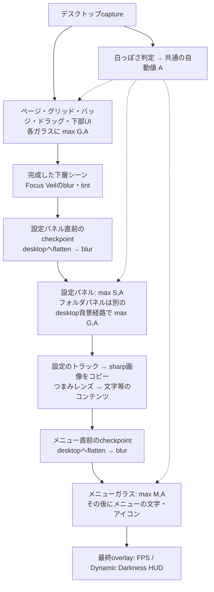
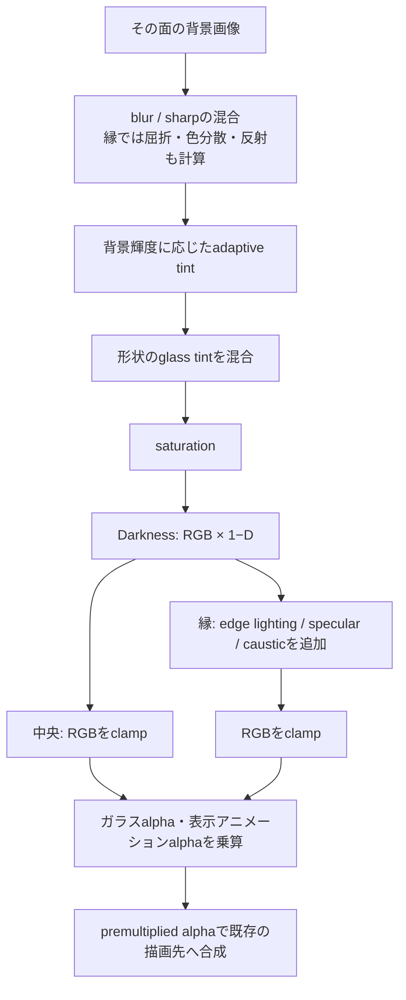
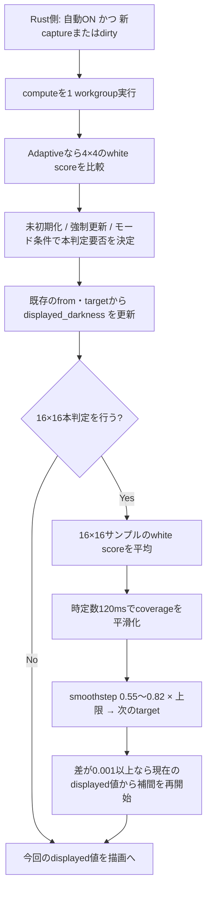
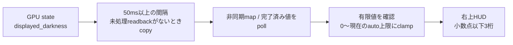

# Darkness：旧方式の調査記録・描画順・修正箇所

> 2026-09-29追記: main `2d5d41f`の取り込みでDynamic Darknessは局所トーン補正方式へ変更されました。
> 現在のアルゴリズムとHUDの意味は[PERCEPTUAL_DARKNESS.md](PERCEPTUAL_DARKNESS.md)を参照してください。
> 以下は変更前の調査記録です。白判定・時間補間・自動値の合成式・HUDの説明を現在の仕様として使用しないでください。

更新日: 2026-09-25。参照基準: `3a83cb4` と、この作業ツリーの値表示トグルの移動・改称、自動Darknessの初期値ONへの変更。

これは**2026-09-25時点の実装から整理した動作の記録**です。末尾の見直し候補は未実装で、決定済みの新仕様ではありません。
対象は本体アプリのLiquid Glassです。`liquid_glass_studio`の独立したプレビュー経路は対象外です。

## 1. 最初に押さえること

- Dynamic Darknessは、取り込んだ背景の「白っぽさ」から求める**全ガラス面共通の1つの値**。面ごとの局所判定ではありません。
- 各面の直接の暗さは `max(その面の手動値, 自動値)`。加算ではありません。
- 設定画面・コンテキストメニューの手動値は、通常ガラスの手動値を**置き換えます**。
- ただし、この2つの面は完成済みの下層シーンを背景にするため、下層の暗さを間接的に引き継ぎます。
- DarknessはガラスのRGBを暗くします。ガラスのalphaや、後から描く文字・アイコンの色を直接変更しません。
- 縁の光はDarknessの後で加わります。`Darkness = 1`でも縁まで完全に黒くなるとは限りません。
- 設定のつまみ用ガラスレンズは例外で、手動・自動Darknessを直接適用しません。
- 右上HUDの数値は**自動値だけ**です。手動値と合成した各面の実効値ではありません。

## 2. 設定と保存範囲

| UI／役割 | 保存フィールド／型 | 初期値 | 範囲・保存 |
|---|---|---:|---|
| 背景に合わせてガラスを暗くする | `liquid_glass.auto_darkness_enabled` | ON | 保存する |
| Dynamic Darkness の値を表示 | `show_auto_darkness_value` | OFF | 保存する。Darknessカテゴリの2行目 |
| 判定モード | `AutoDarknessUpdateMode` | Adaptive | FullRate / Adaptive / Fixed8Hz。セッション限り |
| Dynamic Darkness の上限 | `liquid_glass.auto_darkness_max` | 0.16 | 0〜1、保存する |
| ガラス全体の黒さ | `liquid_glass.glass_darkness` | 0 | 0〜1、保存する |
| コンテキストメニューの黒さ | `liquid_glass.context_menu_glass_darkness` | 0 | 0〜1、保存する |
| 設定画面の黒さ | `liquid_glass.settings_panel_glass_darkness` | 0 | 0〜1、保存する |

Liquid Glass本体のマスタースイッチはDebugカテゴリにあり、初期値はONです。
マスターOFFではガラス描画自体をスキップするため、上記設定によるガラスへの効果も出ません。
Dynamic DarknessのON/OFFと「値を表示」は独立しています。
自動Darknessの初期値ONは新規設定・設定項目が未保存の場合・初期値へのリセットに適用します。保存済みのOFFは維持します。

「Liquid Glassを初期値に戻す」はDarknessの手動値・上限・自動ON/OFFもリセットします。
表示トグルはトップレベルの設定であり、このLiquid Glass専用リセットの対象ではありません。
判定モードもこのリセットでは変更されません。

根拠: [保存設定と範囲](../src/domain/settings.rs)、[実行時パラメータ](../src/liquid_glass/params.rs)、
[操作処理](../src/app/update.rs)、[設定UI](../src/layout/settings_panel.rs)、
[リセット実装](../src/liquid_glass/renderer.rs)の`reset_params_to_defaults`。

## 3. 場所ごとの影響範囲

この表の「背景」は、ガラスシェーダーがサンプルする画像です。
「直接値」はその面のガラス材質に適用する値であり、画面上の最終的な暗さそのものではありません。

記号: `G` = 通常ガラス手動値、`S` = 設定画面手動値、`M` = メニュー手動値、`A` = 自動値。

| 場所・面 | サンプルする背景 | 直接値 | 下層の影響・備考 |
|---|---|---|---|
| ページ枠・通常のベースガラス | デスクトップcaptureとそのblur | `max(G, A)` | 最初のガラス描画 |
| 閉じたフォルダの容器 | デスクトップcaptureとそのblur | `max(G, A)` | 描画順はグリッド内。背景の再採取はしない |
| ドラッグ中フォルダのガラス | デスクトップcaptureとそのblur | `max(G, A)` | 独立した形状描画 |
| 編集モードの削除バッジのガラス | デスクトップcaptureとそのblur | `max(G, A)` | バッジの記号は別途描画 |
| 下部カプセル・歯車のガラス | デスクトップcaptureとそのblur | `max(G, A)` | 文字・歯車の線は後から描画 |
| 開いたフォルダのパネル | デスクトップcaptureとそのblur | `max(G, A)` | 設定パネル用の描画関数・bufferを共用するが、設定画面専用値は使わない |
| 開いたフォルダ内の削除バッジ | デスクトップcaptureとそのblur | `max(G, A)` | 通常バッジと同じ設定 |
| 設定画面のパネル | Focus Veil後の完成シーンをdesktopへflattenした画像とそのblur | `max(S, A)` | 背景のページ等に適用済みの`G`・`A`も間接的に含まれる |
| コンテキストメニューのパネル | メニュー直前の完成シーンをdesktopへflattenした画像とそのblur | `max(M, A)` | グリッド・フォルダ等、実際に下にある内容を含む |
| 設定の押下中つまみレンズ（toggle / slider） | パネル・トラック描画後のsharpな完成シーン | 直接適用なし | 背景に含まれる暗さは見える。専用`fs_toggle`を使う |
| 文字・アイコン・トラック等 | 各コンテンツ描画経路 | 直接適用なし | 上層のガラスに取り込まれた場合は、その背景画像の一部として影響する |
| 右上のDynamic Darkness HUD | 最終overlay | 直接適用なし | 自動値の診断表示 |

通常ガラスが重なる場合も、そのシェーダーが完成シーンを読み直すわけではありません。
ただし半透明合成によって下の描画結果は残ります。「サンプル元」と「合成先」は区別してください。

根拠: [面別の描画とuniform上書き](../src/liquid_glass/renderer/frame.rs)、
[bind groupの背景接続](../src/liquid_glass/renderer.rs)の`rebuild_final_bind_groups`、
[面の振り分け](../src/renderer/prepare.rs)。

## 4. 描画順と、暗さが伝わる経路

### 4.1 全体の順序

以下は関連箇所をまとめた図です。設定・フォルダ・メニュー等は表示状態に応じてスキップされます。



Focus VeilはDarknessとは別機能です。下層シーンのぼかしとtintでフォルダ・設定等へ視線を誘導します。
構成の詳細は[GLASS_FOCUS_VEIL.md](GLASS_FOCUS_VEIL.md)を参照してください。

### 4.2 設定画面／メニューで暗さが重なる理由

完成シーンはpremultiplied RGBAとして保持されます。desktopへflattenするときは次の計算です。

```text
F.rgb = Scene.rgb + Desktop.rgb × (1 − clamp(Scene.alpha, 0, 1))
F.alpha = 1
```

`Scene.rgb`には、下層で描画したガラスのDarknessがすでに含まれます。
この`F`をぼかして上層ガラスの材質を作り、その上層のDarknessをもう一度適用します。
自動値`A`を上層背景から再判定するわけではありません。同じ`A`を使います。

例えば、alpha・tint・blur・光を省略して暗くする処理だけを2回通す近似では、
`A = 0.16`なら `C × 0.84 × 0.84 = C × 0.7056` です。
**実際の画素はこの単純な掛け算とは一致しません**が、「同じ0.16でも面によって見え方が違う」理由の一つです。

根拠: [描画順](../src/renderer/frame.rs)、
[flattenシェーダー](../assets/shaders/liquid_glass_scene_flatten.wgsl)、
[完成シーンblurの設計](LIQUID_GLASS_PER_SURFACE_BLUR.md)。

## 5. 1枚のガラスの中での計算順

### 5.1 共通のDarkness式

```text
A = 0                                         自動OFF、または状態が未初期化
A = auto_darkness.displayed_darkness          自動ONかつ初期化済み

D = max(clamp(その面の手動Darkness, 0, 1), A)
C_dark = mix(C_material, black, D)
       = C_material × (1 − D)
```

| 手動値 | 自動値 | 直接の実効値D | 結果 |
|---:|---:|---:|---|
| 0 | 0.16 | 0.16 | 自動値が効く |
| 0.10 | 0.16 | 0.16 | 0.26にはならない |
| 0.30 | 0.16 | 0.30 | 自動値が0〜0.16で動いても直接のDは変わらない |
| 0 | 0 | 0 | DarknessによるRGB変更なし |

UIの「ガラス全体の黒さ」はすべての面に加える共通の追加暗さではありません。
設定・メニューでは専用手動値が選ばれる点に注意してください。

### 5.2 中央の平坦部と縁



中央は`normalized_height >= 1`の高速経路。縁の経路にも同じDarkness関数があります。
修正時には両方の呼び出し位置を確認してください。

中央の主な式（`mix(x,y,t) = x×(1−t)+y×t`）:

```text
R = clamp(backdrop_replacement, 0, 1)
C0 = mix(blurred_background, sharp_background, 0.12 × (1−R))
Y = dot(C0, [0.299, 0.587, 0.114])
T = mix([0.82,0.90,1.0], [1.0,0.98,0.94], smoothstep(0.15,0.85,Y))
C1 = mix(C0, C0×T + T×0.045, 0.55)
C2 = glass_tint.rgb × glass_tint.alpha + C1 × (1−glass_tint.alpha)
C3 = mix([luma(C2), luma(C2), luma(C2)], C2, saturation)
C4 = clamp(C3 × (1−D), 0, 1.45)
```

「背景に応じたadaptive tint」と「Dynamic Darkness」は別の処理です。
自動DarknessをOFFにしても、adaptive tintは通常のガラス材質処理として残ります。
縁では屈折・反射した色を使い、彩度には`0.12 × activation`を加え、Darknessの後に光を加えます。

### 5.3 alphaと最終合成

```text
alpha_translucent = clamp(geometry_alpha × (0.64 + edge_factor×0.26 + tint_alpha×0.5), 0, 0.92)
alpha_glass = mix(alpha_translucent, geometry_alpha, R)
alpha_out = alpha_glass × presentation_alpha
shader_out = [C_final × alpha_out, alpha_out]
destination_rgb = shader_out.rgb + old_destination_rgb × (1−alpha_out)
```

中央では`edge_factor = 0`相当です。Darknessはこのalpha式に登場しません。
半透明の通常ガラスでは暗くしたRGBの下から背景が混ざるため、Dと見かけの暗化率は一致しません。
設定・メニューの`backdrop_replacement`は表示完了時に1となり、面の内側を完成シーンの加工結果で置き換えます。
開閉途中には値が変化します。

つまみレンズの`fs_toggle`は別経路で、sharpな下層画像に局所的な屈折と縁の明暗を加えます。
通常のadaptive tint・saturation・Darkness処理は呼びません。

根拠: [最終シェーダー](../assets/shaders/liquid_glass_final.wgsl)の`fs_main` / `fs_toggle` / `apply_glass_darkness`、
[面別uniform](../src/liquid_glass/renderer/frame.rs)の`render_settings_controls`。

## 6. Dynamic Darknessのアルゴリズム

### 6.1 入力画像とサンプリング範囲

入力は**取り込んだdesktopの未blur背景テクスチャ**です。設定・メニューの完成シーン画像ではありません。
シェーダーは入力テクスチャ全体の正規化UVを使います。

```text
UV(x,y,N) = ((x+0.5)/N, (y+0.5)/N)
本判定: N=16 → 256点
Adaptiveの変化検出: N=4 → 16点
```

したがって「ガラス内の画素だけ」「メニューの直下だけ」「文字の背後だけ」の判定ではありません。
CPU captureの切り出し経路では、ガラス形状群とpaddingから求めたcapture領域全体が判定母集団になります。
フルサイズGPU経路とは判定範囲が変わり得ます。位置・サイズ変更の評価ではcapture経路も記録してください。

輝度式はサンプルしたRGBにそのまま適用します。判定シェーダー内にsRGB線形化や知覚コントラストの計算はありません。
閾値は現在のcapture色値を前提とする調整値で、物理輝度の55%／82%等を意味しません。

### 6.2 全体フロー



### 6.3 各点の「白っぽさ」

以下で`S(a,b,x)`は`smoothstep(a,b,x)`を表します。

```text
t = clamp((x−a)/(b−a), 0, 1)
S(a,b,x) = t² × (3−2t)

Y = 0.299R + 0.587G + 0.114B
Chroma = max(R,G,B) − min(R,G,B)
Bright = S(0.68, 0.90, Y)
Neutral = 1 − S(0.10, 0.26, Chroma)
WhiteScore = Bright × Neutral
```

| 入力の特徴 | WhiteScoreの傾向 |
|---|---|
| 白 `[1,1,1]` | 1 |
| 黒 `[0,0,0]` | 0 |
| 暗い無彩色、Y≤0.68 | 0 |
| 明るい無彩色、Y≥0.90 | 1 |
| 中間の無彩色 `[0.79,0.79,0.79]` | 0.5 |
| 強い色味、Chroma≥0.26 | 明るくても0 |

平均輝度だけを見るアルゴリズムではありません。**明るさと色味の少なさの両方**が必要です。

### 6.4 coverageと平滑化

```text
coverage = Σ WhiteScore(i) / 256
dt = max(now − last_full_update_at, 0)
filter_alpha = 1                         初回
filter_alpha = 1 − exp(−dt / 0.12)       2回目以降
filtered = previous_filtered × (1−filter_alpha) + coverage × filter_alpha
```

coverageは連続スコアの平均であり、二値判定した「白い画素の面積率」ではありません。
全点が0.5の薄いグレーならcoverageは0.5です。
0.12秒は時定数であり、「120ms後に完全に追いつく」という意味ではありません。

### 6.5 目標Darkness

```text
target = S(0.55, 0.82, filtered) × clamp(auto_darkness_max, 0, 1)
```

| filtered coverage | 目標値（上限0.16） |
|---:|---:|
| ≤0.55 | 0 |
| 0.60 | 約0.0144 |
| 0.685 | 0.0800 |
| 0.75 | 約0.1333 |
| ≥0.82 | 0.1600 |

この表は目標値です。表示値は次の補間を経るため、入力変更直後には一致しません。

### 6.6 表示値への補間

```text
duration = 0.18秒       target > from（暗くする方向）
duration = 0.30秒       それ以外（暗さを弱める方向）
t = clamp((now − transition_started_at) / duration, 0, 1)
displayed = mix(from, target, t²×(3−2t))
```

- 初回は`from=0`、算出した`target`へ向かって開始します。
- 既存targetとの差が`0.001以上`になったときだけ、新しいtargetへ切り替えます。
- 切替時は、その時点の`displayed`を新しい`from`にして補間を再開始します。
- `displayed`の計算はtarget更新より先です。新targetは同じdispatchで即座に表示値へ代入されません。
- 背景が変わり続けると、coverage平滑化とtarget再設定が続きます。反応時間全体を180ms／300msだけでは表せません。

### 6.7 本判定の更新モード

全モード共通で、未初期化または`flags & 1 != 0`なら本判定を実行します。

| モード | その他の実行条件 | 補足 |
|---|---|---|
| FullRate（0） | compute呼び出しのたびに実行 | ディスプレイの毎フレームを保証する名前ではない |
| Adaptive（1、初期値） | 前回本判定から125ms以上 **または** probe平均差≥0.035 | 4×4 probeを使用 |
| Fixed8Hz（2） | 前回本判定から125ms以上 | 強制更新等は125ms未満でも実行 |

Adaptiveの変化量:

```text
probe_delta = Σ abs(current_probe_score(i) − saved_probe_score(i)) / 16
```

比較先は**前回の本判定時に保存したprobe**です。直前のcompute呼び出しとは限りません。
小さい変化が続いても、保存値からの差が閾値に届くと本判定します。

根拠: [判定・平滑化・補間の全コード](../assets/shaders/liquid_glass_backdrop_stats.wgsl)。

## 7. 更新タイミング・状態変更で注意する点

### 7.1 「補間は毎フレーム」とは限らない

Rust側の`render`は、自動ONでも`captured || backdrop_stats_dirty`でなければcomputeを呼びません。
シェーダー内では本判定を省略した回にも補間しますが、**compute自体を省略した描画フレームには補間も進みません**。
時刻uniformを書き換えるだけでは`displayed_darkness`は変わりません。

そのため、新captureが来ない／captureが延期される経路では、遷移中の値が次のdispatchまで据え置かれ得ます。
Windowsの`should_capture`には`defer_backdrop_capture`時に初回以外を抑止する分岐があります。
macOS側は最新captureを継続取得する分岐です。

### 7.2 モードより優先されるdirty

`backdrop_stats_dirty`はcomputeの強制本判定フラグにもなります。
自動ON/OFF、上限変更、判定モード変更、背景viewの再bind、resizeなどで立ちます。
とくに`GpuCaptureFrame::New`で`bind_backdrop_view`を通るとdirtyになります。
この経路が連続する場合、Adaptive／Fixed8Hzでも125ms制限より強制更新が優先されます。
実際の頻度はcapture backendのフレーム供給方法に依存します。

### 7.3 上限を下げた瞬間

新しい`target`は新上限以下になりますが、シェーダーは既存の`displayed`を新上限で即clampしません。
既存値から新目標へ補間するため、**遷移中の自動値が新しい上限を一時的に上回る場合があります**。
一方、HUD用readbackは取得値を現在の上限でclampします。この間はHUDと描画で値が異なり得ます。
これはコードから導ける挙動で、実機での再現・体感評価は別途行う対象です。

### 7.4 OFF／再ON

自動OFFでは最終シェーダーの自動寄与は即0になります。手動値があればそちらが残ります。
OFFへの切替には自動値のフェードアウト処理はありません。
再ON時は状態bufferを初期化し、0から新しい目標へ向かいます。

### 7.5 コードコメントと実処理の差

判定シェーダーのコメントには「判定境界近くではfull rate」とありますが、現在の実行条件に
`filtered_coverage`が境界付近かどうかを見る分岐はありません。
実際のAdaptive条件は「125ms経過」「probe差」「強制更新／未初期化」です。
修正時にはコメントを仕様の根拠にせず、この条件式を基準にしてください。

根拠: [compute呼び出し条件](../src/liquid_glass/renderer/frame.rs)の`render`、
[dirty・setter・capture分岐](../src/liquid_glass/renderer.rs)、
[シェーダーの実行条件](../assets/shaders/liquid_glass_backdrop_stats.wgsl)。

## 8. HUDの数値は何を示すか



- 表示形式は`Dynamic Darkness: 0.123`。自動OFF時は`Dynamic Darkness: OFF`。
- readback間隔は最低50msで、最大約20回/秒。GPU完了状況によりさらに遅れます。
- 描画を待たせず、最後に取得できた値を表示します。
- 手動値との`max`は含みません。面ごとのD、coverage、targetも表示していません。
- UI説明の「現在の実効値」は自動値を指しています。最終合成後の画素の暗さを示すものではありません。
- Liquid GlassマスターOFF時はreadback側の戻り値が0になります。表示文字列のON/OFF判定は自動設定なので、自動ONなら`0.000`表示になり得ます。
- GPUシナリオQAではHUDを明示的に非表示にします。トグル配置は確認できますが、数値表示の確認には通常起動が必要です。

根拠: [HUD生成](../src/app/render/overlay.rs)、
[非同期readback](../src/liquid_glass/renderer.rs)の`encode_auto_darkness_debug_readback` / `poll_auto_darkness_debug_value`。

## 9. 修正内容から実装箇所を引く

| 変えたいこと | 主な修正箇所 | 一緒に見るもの |
|---|---|---|
| 白判定の明るさ・色味の閾値 | `liquid_glass_backdrop_stats.wgsl`の`white_score` | 白背景、グレー、明るい有彩色の比較 |
| 自動補正が立ち上がる背景割合 | 同ファイルの`next_target` | 0.55 / 0.82、上限との関係 |
| 応答の速さ・ちらつき | 同ファイルのfilterと`interpolated_darkness` | 120ms時定数、180/300ms、0.001、dispatch間隔 |
| 本判定の頻度・負荷 | 同ファイルのmode分岐、Rustのdispatch条件 | dirtyでの強制更新、capture停止時の補間 |
| 手動と自動を加算等に変更 | `liquid_glass_final.wgsl`の`apply_glass_darkness` | 全通常ガラス面に波及。0〜1制約も決める |
| 縁も含めて暗くする | 同ファイルのDarkness呼び出し位置 | 中央と縁の両経路、ハイライトの保持方針 |
| 面ごとに自動値を変える | state・uniform・bind group・compute・面別render | 現在は共通buffer。局所画像、ROI、複数stateの設計が必要 |
| 下層の暗さを上層へ持ち込む量 | 完成シーンcheckpoint、flatten、面の背景選択 | blur・アイコンの透け方・backdrop replacementと不可分 |
| 設定つまみも暗くする | `render_settings_controls`と`fs_toggle` | トラックの緑、透明感、既存のレンズ回帰テスト |
| HUDで各面の実効値も表示 | `app/render/overlay.rs`とreadback | Aとmax(G,A)/max(S,A)/max(M,A)を区別 |
| 初期値・保存方式を変える | `domain/settings.rs`と`liquid_glass/params.rs` | 古い保存データのserde default、reset、rendererへの反映 |
| 設定の並び・文言を変える | `layout/settings_panel.rs`、`app/render/settings.rs` | row count・scroll・hit map、既存テスト |

GPU stateの構造を変える場合は、RustとWGSLの両方を変更します。
`AutoDarknessUniforms`は16 bytes、`AutoDarknessState`は96 bytesが現行の契約です。
本体だけでなく`liquid_glass_studio`、`tests/wgsl_validation.rs`にも同等の構造定義があります。
最終シェーダーのbuffer layoutとテストのサイズ定数も同期してください。

自動値はUIモデル外で時間変化するため、`renderer/frame.rs`のscene cache keyにも関連します。
判定頻度を下げても、完成シーンblurや再描画のコストまで同じ割合で下がるとは限りません。

### 主なソースへのリンク

- [自動判定シェーダー](../assets/shaders/liquid_glass_backdrop_stats.wgsl)
- [ガラスの色・Darkness・alpha・つまみシェーダー](../assets/shaders/liquid_glass_final.wgsl)
- [flattenシェーダー](../assets/shaders/liquid_glass_scene_flatten.wgsl)
- [面別render・compute dispatch](../src/liquid_glass/renderer/frame.rs)
- [state・setter・readback・背景bind](../src/liquid_glass/renderer.rs)
- [frame全体の順序・cache key](../src/renderer/frame.rs)
- [render modelから面を選択](../src/renderer/prepare.rs)
- [永続設定](../src/domain/settings.rs) / [実行時の初期値・モード](../src/liquid_glass/params.rs)
- [UIレイアウト](../src/layout/settings_panel.rs) / [UI文言と状態接続](../src/app/render/settings.rs)
- [設定操作](../src/app/update.rs) / [保存とrendererへの設定反映](../src/app/command.rs)
- [HUD](../src/app/render/overlay.rs)

## 10. 見直し時に決めたいこと（未決定）

| 論点 | 現状 | 選択肢・判断材料 |
|---|---|---|
| 自動補正の目的 | 広い範囲が白っぽいときにガラスを暗化 | 文字の可読性、材質の統一、白背景抑制のどれを優先するか |
| 判定範囲 | capture全体 | ページ内、面ごと、文字周辺。小さい白領域を拾う必要があるか |
| 手動値の意味 | 自動値に対する下限に近い`max` | 固定値、追加値、上限、補正強度として扱うか |
| 面の独立性 | 手動は一部独立、自動は共有、下層の色は継承 | パネルごとに見かけの暗さを揃えるか、重なりを表現するか |
| 上限の意味 | targetの上限 | 表示値にも即時適用する厳密な上限にするか |
| 動きの連続性 | capture/dirty時に補間を評価 | captureが止まっても表示フレームごとに補間するか |
| 縁の明るさ | Darkness後に光を追加 | 縁を残すか、材質全体を同率で暗化するか |
| 診断表示 | 自動のdisplayed値のみ | target、coverage、面別D、更新回数も見たいか |

## 11. 修正後の確認観点

以下は今後の変更用チェックリストです。この資料作成だけで全ケースを実機検証したものではありません。

| ケース | 確認すること |
|---|---|
| 黒・白・中間グレー・明るい有彩色 | white scoreと補正の有無 |
| 白領域が少量／半分／ほぼ全面 | filtered coverageと目標値の立ち上がり |
| 手動値が自動値より小／同／大 | `max`の期待値、HUDとの違い |
| ページ・フォルダ・設定・メニュー | 各面の直接値と下層継承、文字が直接暗くならないこと |
| 下部カプセル・歯車・削除バッジ | 通常ガラスと同じ値が届くこと |
| 設定つまみの押下・ドラッグ・解放 | レンズの透明感、トラック色 |
| 白→黒／黒→白／小刻みな切替 | 平滑化と補間、再target時の追従 |
| 遷移中にcaptureを止める・延期する | displayed値の停止／再開 |
| 上限を大きい値から小さい値へ変更 | target、displayed、HUDの差 |
| 自動OFF→ON、マスターOFF→ON、再起動 | 状態初期化、保存、モードの非保存 |
| ウィンドウの移動・resize・capture経路変更 | 判定範囲、dirty、境界・色の不連続 |
| HUD表示のON/OFF | 表示だけの変更でGPU待機を増やさないこと |

既存テストの入口:

```powershell
cargo test --bin launchpad-windows settings_panel
cargo test --test wgsl_validation auto_darkness
cargo test --test wgsl_validation toggle_lens_preserves_sharp_scene_colors_even_with_panel_effects_enabled
```

`auto_darkness_compute_respects_maximum_and_update_modes`はGPU上の判定モード等を確認します。
`auto_darkness_uses_parallel_reduction_and_per_frame_interpolation`はシェーダーの構造を確認しますが、
Rust側でdispatchされなかったフレームの補間継続を保証するテストではありません。

表示確認は[EDIT_MODE_VISUAL_QA.md](EDIT_MODE_VISUAL_QA.md)のcapture設定を使います。
`LAUNCHPAD_ALLOW_SCREENSHOT=1`が必要です。
設定操作の再生は[GPU_SEQUENCE_QA.md](GPU_SEQUENCE_QA.md)を参照してください。
通常のGPUシナリオではdesktop captureとHUDが制限されるため、実背景に応答するアルゴリズムと数値HUDは通常起動でも確認します。
