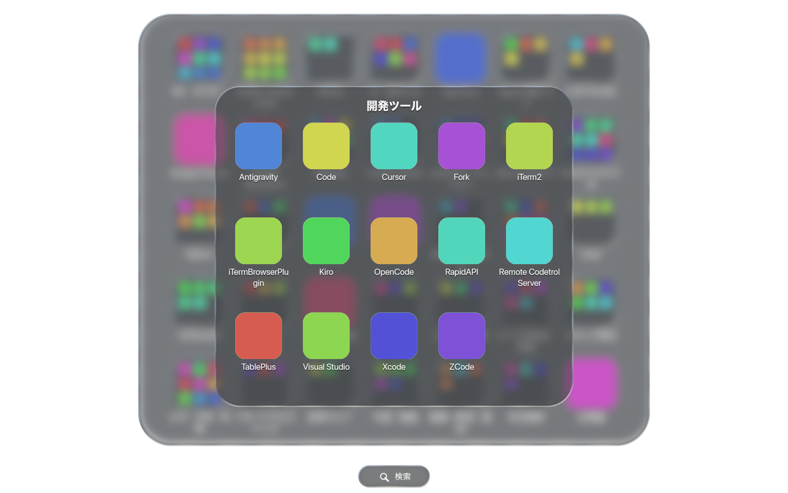
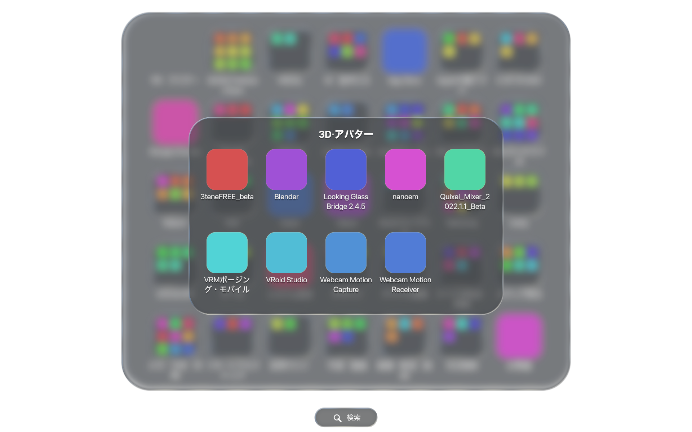
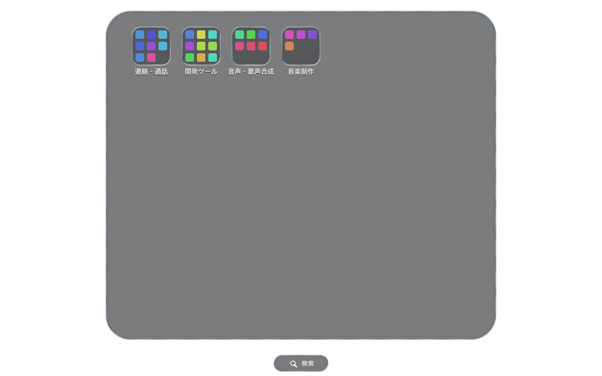

# macOSの初期フォルダ分類（カタログv7）

Mac実機のアプリを全件確認し、製品セットと用途別の初期フォルダを実装した。
**270個のアプリ束と1件のSteam manifestを監査し、表示対象217件を33フォルダ・6単体へ分類した。未判定は0件。**
[全件の所属・理由・除外記録](MACOS_APP_CLASSIFICATION_AUDIT.md)に、一件ずつ判断を記載している。

## 分類方針

- Adobe、Affinity、Steinberg、Maxon、Unity、JetBrains、Live2D、CLIP STUDIO、VOCALOID、Apple文書アプリ、Google Workspace等の製品セットを優先する。
- セット外の既知アプリは、開発、AI・音声入力、3D・アバター、デザイン、写真・画像、映像・配信・演出、音楽制作、音声・歌声合成、連絡・通話、メモ・予定・作業、メディア再生、ファイル転送・同期、仮想マシン、Macカスタマイズ、デバイス連携、生活情報、ゲーム、PDFへ分類する。
- ブラウザ・Store・OS設定・電卓・Steamクライアントは日常の入口として直接表示する。
- `CFBundleIdentifier` の完全一致で判定する。数値版は同じ製品キーにまとめる。表示名・メーカー接頭辞・著作権・OSのカテゴリ宣言だけでは決めない。
- Illustrator同梱のAppleScriptサンプルだけは、汎用のScript Editor生成IDに加えて所有ディレクトリを確認する。
- 製品の診断・導入・削除・補助ツールも所属先を明示し、未知のヘルパーを接頭辞で一括分類しない。補助ツールや版違いだけで2製品条件を満たさないよう、所有製品と同じキーを使う。
- 異なる製品・独立機能と起動対象が2種類以上あるときだけフォルダを作る。不明なアプリや条件未達の単体は直接表示に残す。
- 初回と設定の「設定をリセット」で適用する。生成直後は「フォルダ分けをリセット」で取り消せる。既存ユーザーの保存済み配置へ自動適用しない。
- トップレベルもフォルダ内もMacでは名前順。アプリ本体、Applications内の配置、OS設定は変更しない。実行時の外部通信やAIは不要。

Windowsの既存ルール・優先順は維持する。カタログの新しい用途プリセットはMac専用。

## 全量スキャンへの対応

通常のMacスキャンとSteam providerを併合して監査する。
以前はMacのアプリ束だけを監査していたため、Steam manifestを漏らしていた。
また、Steamの生成ショートカット2件はXML末尾のNULで読み取りに失敗し、スキャンをpartialとしていた。

生成された `run.sh` が厳密な `open steam://run/<数字>` の場合だけNUL付きXMLを復旧し、`steam:<ID>` として識別する。
Desktop Mateのmanifestとショートカットは一件に統合し、Civilization VIのショートカットも保持する。
スクリプトを実行せず、任意の破損アプリや追加コマンド付きスクリプトは復旧しない。既に読み取れていたショートカットのパスIDは維持し、保存済み配置の識別子を変更しない。

監査は通常の深さ制限を超える2個の旧Mocha AEも記録するが、通常の検出範囲は拡大しない。
Parsec等のバックグラウンド専用7個、同じ識別子の重複44個も全件記録する。
`LSBackgroundOnly=true` の除外は既存のスキャナー方針。プラグインや埋め込みアプリから起動項目を合成しない。

## 実機結果

| 配置案 | 検出件数 | 単体 | フォルダ | フォルダ内 | トップレベル合計 |
| --- | ---: | ---: | ---: | ---: | ---: |
| v6、全providerを併合（partial） | 216 | 141 | 13 | 75 | 154 |
| v7、Steamショートカット対応後（complete） | 217 | 6 | 33 | 211 | 39 |

v7では新たに読み取れたCivilization VIを加え、全217件を一度ずつ保持する。
収納率を目的に無理にまとめず、用途と関連製品を確認したものだけを分類した。
全33フォルダの内容と、直接表示6件の理由は[全件監査表](MACOS_APP_CLASSIFICATION_AUDIT.md)で確認できる。

```sh
cargo run --locked --example macos_initial_layout_audit > target/macos-layout-full-audit.json
```

監査exampleは保存DBへ触れず、全providerの配置案とアプリ束の検出・重複・除外をJSONに出力する。
ホームパスのユーザー名は `~` に置換する。別端末や追加アプリのある環境では件数が変わる。

## 検証

`tests/macos_initial_folder_layout.rs` は実機217件の期待する所属を固定し、次を検証する。

- 全217件の所属・製品キー・判断理由。33フォルダ・6単体・211子要素、未判定なし、欠落・重複なし。
- 初回、明示的なリセット、保存後の取り消しで全件を保持する。
- 表示名・著作権変更、未知のヘルパー、Mac用IDをWindowsへ適用する誤分類を防ぐ。
- Synthesizer VのBasic/Pro/2 Pro、AE・Cubase・Premiereの版違い、同じ製品の補助ツールだけではフォルダを作らない。
- IllustratorのサンプルIDは所有ディレクトリを確認し、個人スクリプトを分類しない。
- WindowsのVS Code等の入口を直接表示する既存動作を維持する。

`src/platform/macos/apps.rs` では、SteamのNUL付きXMLと同じIDへの統合、生成スクリプトの厳密な認識、任意の破損XMLの拒否、通常スキャンと全量監査の表示対象の一致を検証する。

GPUシナリオ `qa/macos_initial_folder_layout_reset.json` も217件全件を使う。表示倍率1.5を指定し、Macから後続の倍率通知が来てもQAの指定を維持する。
生成直後の39項目、開発ツール14子・3Dアバター9子の開閉、2ページ目、設定UIでの取り消し→設定リセット→取り消しを再生する。
検証器は39→217→39→217の件数遷移と、6単体・33フォルダ・取り消し後の217個のIDを検査する。
アイコンはQA用fixture画像。実アプリアイコンの外観確認は含まない。

```sh
LAUNCHPAD_ALLOW_SCREENSHOT=1 LAUNCHPAD_QA_HEADLESS=1 \
LAUNCHPAD_QA_SCENARIO=qa/macos_initial_folder_layout_reset.json \
cargo run --release --locked
python3 scripts/verify_qa_artifact.py target/qa-sequences --allow-partial
```

Mac実機のMetal描画で134フレームをキャプチャし、上記の件数・ID・フォルダ開閉・ページ移動の契約が成功した（1920×1200、表示倍率1.5）。

PRの `qa:macos-visual` ラベルも同じ全件シナリオを実行する。







