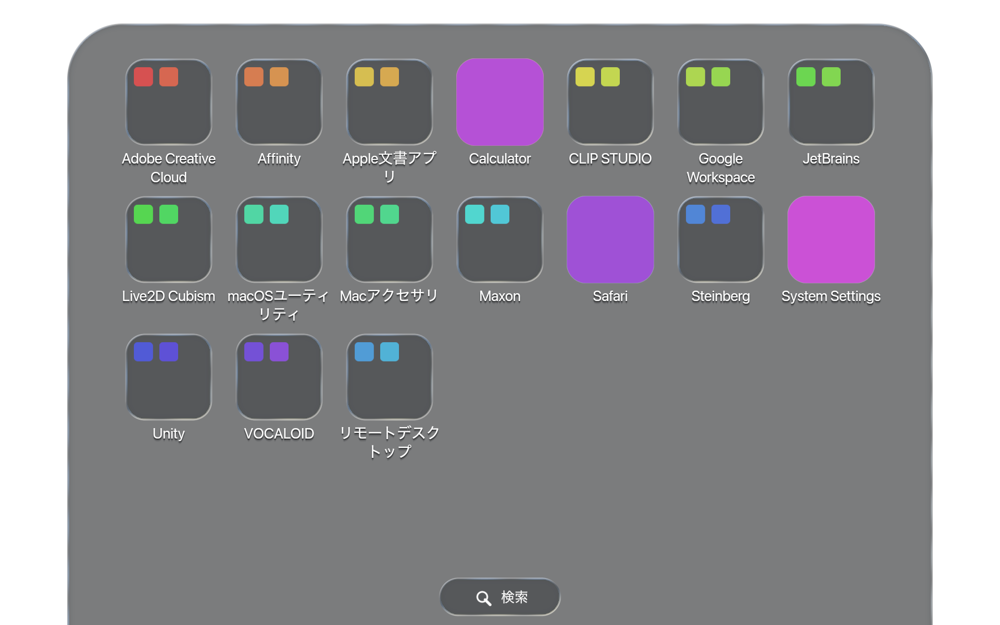
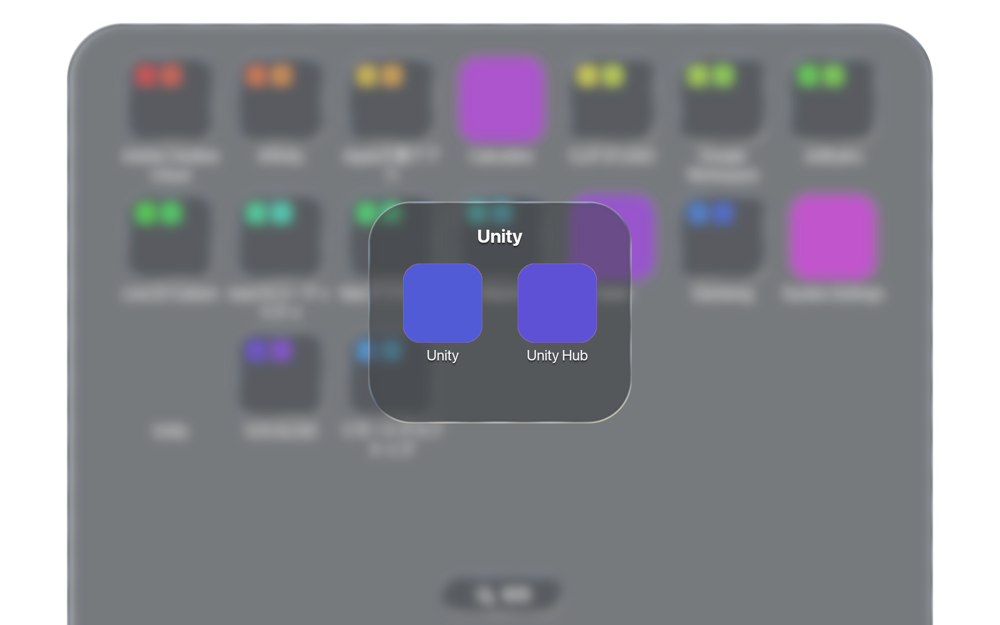

# macOSの初期フォルダ分類（カタログv6）

2026-09-30にMac実機のアプリの `Info.plist` と、productionのアプリスキャナーを使って確認した。
同梱ルールは `src/domain/initial_layout/catalog/macos.rs`、実測メタデータの正例・負例は `tests/fixtures/macos_catalog_observed.json` にある。
元からあるMacのルールを同じモジュールへ移し、Windowsの判定条件は維持している。

## 分類方針

- `CFBundleIdentifier` の完全一致で製品を判定する。名前、翻訳、配置場所、著作権表記、メーカーの接頭辞だけでは決めない。
- 同じ製品群の異なる製品・付属機能が2種類以上あるときだけフォルダを作る。同じアプリの複数版や重複した起動対象だけでは作らない。
- 初回と設定の「設定をリセット」で適用する。更新時に既存のフォルダ・手動配置へ自動適用しない。生成直後は「フォルダ分けをリセット」で取り消せる。
- Macのトップレベルとフォルダ内は従来どおり名前順。不明なアプリは直接表示し、検出済みのアプリを削除しない。
- 実行時の外部通信やAIの使用はない。アプリ本体やApplicationsディレクトリの配置も変更しない。

## 追加・修正した分類

| フォルダ | 今回の対応 | 境界 |
| --- | --- | --- |
| macOSユーティリティ | 従来のアクティビティモニタ・コンソール・ディスクユーティリティに、ターミナル、システム情報、Audio MIDI設定、移行アシスタント、プリントセンター、AirMac、Bluetoothファイル交換、Boot Camp、ColorSync、Digital Color Meter、Grapher、VoiceOver、スクリプトエディタ、Automator、Font Book、イメージキャプチャを追加 | Appleの管理・診断・自動化ツールの明示した19 ID。Apple製全アプリは含めない |
| Macアクセサリ | テキストエディット、スクリーンショット、QuickTime Player、辞書、ボイスメモ、スティッキーズ | 新規プリセット。Safari・電卓・設定・メモ等は直接表示 |
| Adobe Creative Cloud | After Effects 2026の `com.adobe.AfterEffects.application`、Bridge、InDesign、Creative Cloud本体を追加 | AE旧IDと新IDは同じ製品。Helper・CCXProcess・Core Sync・installer・uninstaller・プラグイン・Render Engineは追加しない |
| Maxon | Cinema 4DにCommandline、Team Render Client、Team Render Serverを追加 | `net.maxon.commandline` / `cinema4dclient` / `cinema4dserver`。Python環境・uninstaller等を接頭辞で一括分類しない |
| Steinberg | Cubase LE/AI/Elements (`com.steinberg.cubasesoft<数値版>`)、単体のGroove Agent SEとHALion Sonic、Activation Manager、Library Manager、Download Assistantを追加 | Cubaseの別版・エディションは同じ製品キー。VSTプラグインやアンインストーラは追加しない |
| JetBrains | 実機にあるRustRoverとAirを追加 | 既存IDE・Toolboxに完全一致IDを追加。未知の `com.jetbrains.*` は収納しない |
| Unity | MacでもEditor・Hub・Bug Reporterを同じプリセットへ | `com.unity3d.UnityEditor5.x` / `unityhub` / `bugreporter`。Editorだけの複数インストールではフォルダを作らない |
| Live2D Cubism | MacのEditorとViewerを追加 | `com.live2d.cubism.CECubismEditorApp` と実測したViewerの完全なID |
| Google Workspace | Google Docs・Sheets・Slidesの起動アプリ | 新規プリセット。`com.google.drivefs.shortcuts.docs` / `sheets` / `slides`。Google Drive同期アプリやChromeは含めない |
| CLIP STUDIO | CLIP STUDIO本体とPAINT | 新規プリセット。`jp.co.celsys.CLIPSTUDIO` / `CLIPSTUDIOPAINT`。認証・内部モジュールは含めない |
| VOCALOID | VOCALOID6 EditorとVOCALOID Authorizer | 新規プリセット。`com.yamaha.VOCALOID6-Editor` / `VOCALOID-Authorizer`。アンインストーラや音源を合成しない |
| リモートデスクトップ | MacのParsecと画面共有を追加 | `tv.parsec.www` / `com.apple.ScreenSharing`。2製品条件を満たす検出結果だけで生成 |

Apple文書アプリ、Affinity、Office、Final Cut、Logic、その他の既存Macルールも継続する。
Officeの3 IDは既存の公式資料によるルールを移したもので、今回の実機にOfficeを導入して確認したものではない。

今回のParsecは `LSBackgroundOnly=true` のため、既存スキャナーの除外方針により検出結果へ入らない。
実機では画面共有だけなのでリモートデスクトップフォルダを作らず、画面共有を直接表示する。
102件のメタデータfixtureと31件のGPU fixtureは分類器の検証用であり、すべての項目がスキャナーの表示対象になることを意味しない。

## 実機の読取専用診断

```sh
cargo run --locked --example macos_initial_layout_audit > target/macos-layout-audit.json
```

productionのスキャナーから配置案だけを生成する。保存済みのDBや実際の配置へ適用しない。
レポートはフォルダ名・アプリ名・Bundle IDを出力し、ユーザーの絶対パスは出力しない。

同じ215アプリを旧v5とv6で比較した結果:

| カタログ | 単体アプリ | フォルダ | フォルダ内アプリ | トップレベル合計 |
| --- | ---: | ---: | ---: | ---: |
| v5 | 190 | 5 | 25 | 195 |
| v6 | 140 | 13 | 75 | 153 |

v6のフォルダ内訳は、Adobe 14、Affinity 2、Steinberg 6、Unity 3、VOCALOID 2、Apple文書アプリ4、CLIP STUDIO 2、Google Workspace 3、JetBrains 8、Live2D 2、Macアクセサリ6、macOSユーティリティ19、Maxon 4。
全215アプリを重複なく保持する。既存の読み取れないbundleがあるためスキャン完了状態はpartialであり、この件数はその時点の取得済み集合に対する結果。

## 検証

`tests/macos_initial_folder_layout.rs` で以下を検証する:

- 実測102件のIDで所属・製品キー・非対象アプリを判定し、表示名・配置先・著作権変更やヘルパーIDの誤検出を防ぐ。
- 初回、明示的リセット、保存後の取り消しで、全アプリを一度ずつ保持する。
- Mac標準アプリをアクセサリ・ユーティリティ・画面共有へ分け、日常アプリは直接表示する。
- AEの旧新ID、Cubaseの別エディション、Premiereの版違い、Unity/PAINTの重複だけではフォルダを生成しない。

GPUシナリオは `qa/macos_initial_folder_layout_reset.json`。実測IDを使う31アプリから14フォルダ＋3単体を生成し、Unityフォルダの開閉と、productionの設定UI経由の取り消し→設定リセット→取り消しを再生する。

```sh
LAUNCHPAD_ALLOW_SCREENSHOT=1 LAUNCHPAD_QA_HEADLESS=1 \
LAUNCHPAD_QA_SCENARIO=qa/macos_initial_folder_layout_reset.json \
cargo run --release --locked
python3 scripts/verify_qa_artifact.py target/qa-sequences --allow-partial
```

検証器はトップレベル件数が17→31→17→31と変化すること、生成したUnityフォルダが2アプリを持って開くことを確認する。
fixtureのアイコンはQA用の色付き画像。productionのGPU描画と設定操作を検証するもので、実アプリアイコンの見え方の検証とは分ける。
PRの `qa:macos-visual` ラベルでもこのシナリオを実行し、PNG・manifest・ログをartifactへ含める。

Mac実機のMetal描画で76フレームをキャプチャし、上記の件数遷移とフォルダ開閉を確認した（1920×1200）。




