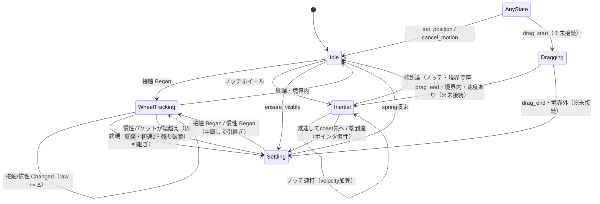

# 設定画面スクロールの状態遷移仕様

作成日: 2026-08-15
対象: 設定画面の縦スクロール `ContinuousScroller`（`src/scroll.rs`）と
入力ルーティング `handle_settings_scroll_sample`（`src/app/update.rs`）

## 1. この文書の目的

体感のフィードバック（「〇〇が変」）を修正に繋げるには、**状態の名前を共有**する
必要がある。本書は実装（コミット `5a7a499` 時点）の状態と遷移を全パターン定義し、
issue #190 の調整で使う共通語彙とする。

- 物理パラメータ（rubber曲線・spring・減衰の数値）は
  `docs/SETTINGS_SCROLL_PHYSICS.md` を参照。本書は**状態と遷移のみ**を扱う。
- 本書の記述は実装に追従する。実装変更時に本書を更新しない記述は無効になる。

## 2. 状態の定義

`ContinuousPhase`（`src/scroll.rs`）の5状態。**「位置を誰が所有しているか」**で
分類できる。

| 状態 | 日本語名 | 位置の所有者 | フレームアニメーション |
|---|---|---|---|
| `Idle` | 静止 | なし（確定値） | なし |
| `WheelTracking` | ホイール追従中 | ネイティブの精密パケット（接触/慣性） | なし（イベント駆動） |
| `Inertial` | 慣性中 | アプリ自前の指数減衰 | あり |
| `Settling` | バネ収束中 | spring（`settle_target` へ収束） | あり |
| `Dragging` | ポインタドラッグ中 | ポインタ変位 | なし |

補足:

- **`Dragging` は現在未接続**。`drag_start/drag_move/drag_end` は API として存在し
  テストも存在するが、設定画面から呼び出している箇所はない（`ScrollView`
  ウィジェットはスクロールバーの描画のみ）。本書では網羅性のため記載する。
- `WheelTracking` 中の表示位置は `rubber(raw)`。raw（未圧縮の累積値）と
  表示（rubber圧縮後）は別物であり、**「raw空間」と「表示空間」**という語を
  使い分ける。

### 補助フラグ: `momentum_tail_cut`

`WheelTracking` に付随するフラグ。「**即反発済み**」を表す。

- momentum パケットが境界を越えた瞬間に `true` になり、**同一momentumシーケンスの
  残りパケットはすべて無視**される。
- 次の接触 Began、または次の momentum Began / 終端（`end_native_momentum`）で
  `false` に戻る。

## 3. イベントの定義

`handle_settings_scroll_sample`（`src/app/update.rs`）がルーティングする入力。
`NativeScrollPhase` は `Began / Changed / Ended / Cancelled / None`。

| イベント | 入力ソース | 呼び出し | 意味 |
|---|---|---|---|
| 接触 Began/Changed/Ended/Cancelled | トラックパッドの指接触（`contact_phase`） | `begin_precise_wheel` / `move_precise_wheel` / `end_precise_wheel` | 指が画面に触れている間 |
| 慣性 Began/Changed/Ended/Cancelled | OS生成の慣性（`momentum_phase`） | `begin_native_momentum` / `move_native_momentum` / `end_native_momentum` | 指を離した後のOS側コースト |
| sequence_complete | 慣性シーケンス終了（ゼロデルタ終端） | `end_native_momentum` | OSの「もうパケットがない」通知 |
| ノッチホイール | `ScrollSource::Line`（非精密マウス） | `apply_line_wheel` | ノッチ1つ分の行単位スクロール |
| tick | 毎フレーム | `tick` | `Inertial`/`Settling` を進める |
| set_position / ensure_visible / cancel_motion | プログラム的 | 各メソッド | フォーカス移動・リセット等 |

ノッチホイールは OS momentum を持たないため、`Inertial`（`line_wheel_decay` で
減衰）がアプリ側で慣性を生成する。トラックパッド（精密）は OS momentum がある
ため `Inertial` を使わない。

## 4. 状態遷移図



`AnyState` は全状態から、を意味する（`drag_start` と接触/慣性 Began は進行中の
どの状態からでも現在の表示位置を引き継いで開始する）。

## 5. 完全な遷移表

「開始状態 × イベント → 終了状態」と、遷移時の重要な副作用。**網羅が目的**なので
読み物としてではなく辞書として使うことを想定している。

### 5.1 接触（トラックパッドの指）

| 開始状態 | イベント | 終了状態 | 副作用と条件 |
|---|---|---|---|
| すべて | 接触 Began | `WheelTracking` | 速度サンプル**初期化**。raw を現在の表示位置相当へ再アンカー。`momentum_tail_cut` 解除。進行中の `Settling`/`Inertial` は中断されるが位置は連続 |
| `WheelTracking` | 接触 Changed | `WheelTracking` | raw += Δ（1:1）、表示 = rubber(raw)。速度サンプル追記 |
| `WheelTracking` 以外 | 接触 Changed | `WheelTracking` | 防御経路: `begin_precise_wheel` が自動で呼ばれてから適用（サンプル初期化が走る） |
| `WheelTracking` | 接触 Ended・境界内 | `Idle` | 速度0で確定。ネイティブmomentumがあるためアプリ側惰性は追加しない |
| `WheelTracking` | 接触 Ended・境界外 | `Settling` | **可視速度**（サンプル推定、viewport×8で上限）をspringの初速へ。target = 境界 |
| `WheelTracking` | 接触 Cancelled・境界外 | `Settling` | 初速0でsettle |
| `WheelTracking` | 接触 Cancelled・境界内 | `Idle` | 速度0で確定 |

接触 Ended 時の注意: その直後に慣性 Began が来るのが通常のトラックパッド操作。
境界外で Ended → `Settling` が始まっても、最初の慣性パケットが表示位置を
引き継いで `WheelTracking` へ戻す（下記 5.2）。

### 5.2 慣性（OS momentum）

| 開始状態 | イベント | 終了状態 | 副作用と条件 |
|---|---|---|---|
| すべて | 慣性 Began | `WheelTracking` | **速度サンプルは保持**（直前の接触で溜めた速度履歴を反発に残す）。raw 再アンカー。`momentum_tail_cut` 解除 |
| `WheelTracking`（tail_cutなし） | 慣性 Changed・境界内 | `WheelTracking` | raw += 境界内成分 × `momentum_gain`（既定 0.4） |
| `WheelTracking`（tail_cutなし） | 慣性 Changed・境界内成分と端越え成分の混合 | `WheelTracking` → `Settling` | **端を越えたパケットは境界内成分も含め全量適用**（フルフォース）。表示が境界外になった瞬間に **即反発**: 初速0、target = 境界、`momentum_tail_cut = true` |
| `WheelTracking`（tail_cutあり） | 慣性 Changed | `WheelTracking`（不変） | **残りパケットはすべて無視**。表示も動かない |
| `Settling` / `Inertial`（tail_cutなし） | 慣性 Changed | `WheelTracking` | 防御経路: `begin_native_momentum` が自動で呼ばれる。接触終端で始まった反発を慣性が引き継ぐ経路 |
| `WheelTracking` | 慣性 Ended / sequence_complete・境界内 | `Idle` | tail_cut解除 → 速度0で確定 |
| `WheelTracking` | 慣性 Ended / sequence_complete・境界外 | `Settling` | tail_cut解除 → **可視速度**をspring初速へ。ただし即反発済み（tail_cut）で既に `Settling` の場合は `end_precise_wheel` が早期returnし何も起きない |
| `WheelTracking` | 慣性 Cancelled | `Settling` / `Idle` | 同上だが初速0 |

### 5.3 ノッチホイール（非精密マウス）

| 開始状態 | イベント | 終了状態 | 副作用と条件 |
|---|---|---|---|
| `Inertial` 以外 / `Inertial`（overscroll不可） | ノッチ Δ | `Inertial` | `inertia_raw` を現在位置（clamp済み）へリセットし、velocity += Δ × `line_wheel_decay`。`inertia_allows_overscroll = false` |
| `Inertial`（ノッチ継続） | ノッチ Δ | `Inertial` | `inertia_raw` はリセットされず、velocity に加算のみ（連続操作として繋がる） |
| 境界にいる状態で外向き Δ | — | `Idle` | `set_position(clamp)` が呼ばれ、進行中のジェスチャも中断される |
| `Inertial` | tick・境界到達 | `Idle` | rubberなし。境界で clamp して停止 |
| `Inertial` | tick・低速 | `Settling` | target = さらなるcoast先（`inertia_raw + v/k`）。残速度はspringへ引き継がれる |

### 5.4 ポインタドラッグ（※現在未接続）

| 開始状態 | イベント | 終了状態 | 副作用と条件 |
|---|---|---|---|
| すべて | drag_start | `Dragging` | 速度サンプル初期化 |
| `Dragging` | drag_move | `Dragging` | 1:1 + rubber |
| `Dragging` | drag_end・境界内・速度 > cutoff | `Inertial` | `inertia_allows_overscroll = true`。`inertia_decay`（3.2/s）でcoast |
| `Dragging` | drag_end・境界外 または 低速 | `Settling` | target = clamp(境界) |
| `Inertial`（ドラッグ由来） | tick・境界越え | `Settling` | 表示速度をspring初速へ変換して反発 |

### 5.5 フレームとプログラム的遷移

| 開始状態 | イベント | 終了状態 | 副作用と条件 |
|---|---|---|---|
| `Idle` / `Dragging` / `WheelTracking` | tick | 不変 | 位置は入力が所有しており、tickでは何もしない |
| `Settling` | tick | `Settling` | 厳密解（critically-damped / underdamped）でspring更新 |
| `Settling` | tick・収束 | `Idle` | `|dx| < settle_eps` かつ `|v| < settle_eps` で確定 |
| すべて | set_position | `Idle` | 即位置確定・速度0（`ensure_visible` 等の強制スクロール） |
| すべて | ensure_visible | `Settling` | target が現在位置から `settle_eps` 以上離れていれば |
| すべて | cancel_motion | `Idle` | 位置はそのまま速度だけ捨てる（フォーカス喪失等） |
| `Idle` | set_sizes | `Idle` | 新しい境界へ clamp。非スクロール化（内容がviewport以下）なら 0 へ |
| `WheelTracking` 等ジェスチャ中 | set_sizes | 不変 | ジェスチャ中はリセットしない（レイアウト再構築が毎フレーム走るため。停止してから確定） |

## 6. 典型シナリオ（フィードバックの座標系）

体感の報告は「**シナリオID + 状態名**」で行うと実装と1:1で対応する。

### シナリオA: トラックパッド弱フリック（境界内で終わる）

```
Idle → WheelTracking（接触）→ WheelTracking（慣性・gain 0.4でcoast）
     → Idle（慣性終端・境界内）
```

### シナリオB: トラックパッド強フリックで下端到達

```
Idle → WheelTracking（接触）→ WheelTracking（慣性）
     → Settling（即反発: 初速0・残り慣性は破棄）→ Idle
```

**issue #190 の主論点**。ネイティブ NSScrollView は「慣性終端まで伸びを累積し、
溜めた速度で反発」するのに対し、本実装は「最初の端越えパケットで即反発（初速0）」
する。`SETTINGS_SCROLL_PHYSICS.md` §5.4 はネイティブ側の挙動を記述しており、
実装と不一致している（§5.4更新または実装変更のどちらが必要かは未決）。

### シナリオC: 端に伸びている最中に指で戻す

```
Settling → WheelTracking（接触 Began がsettleを中断・raw再アンカー）
        → WheelTracking（逆方向1:1）→ ...
```

### シナリオD: 接触終端の反発を慣性が引き継ぐ

```
WheelTracking → Settling（接触 Ended・境界外）→ WheelTracking（慣性 Began が引き継ぎ）
             → Settling（即反応）→ Idle
```

指を離した瞬間に勢いが残っていると、反発が一瞬始まってから慣性に再接続される。
この引き継ぎで速度サンプルは消えない（「途中から強く払った」勢いが反発に残る）。

### シナリオE: ノッチマウスの連続スクロール

```
Idle → Inertial → Inertial（連打でvelocity加算）→ Settling（coast先）→ Idle
```

連打が速いほどvelocityが積み増され、1つの連続した動きとして見える。
端ではrubberなしに停止する。

### シナリオF: 内容がviewport以下

ルーティング段階（`handle_settings_scroll_sample` の冒頭ガード）で入力が落ちる。
`ContinuousScroller` には渡らない。

## 7. フィードバックテンプレート

```
シナリオ: A 〜 F
どこで:   状態名（例: シナリオB の Settling 開始直後）
症状:     具体的な体感（例: 伸びが浅すぎて静止したように見える / 戻りが硬い）
期待:     ネイティブmacOSではどう見えるか
```

## 8. 既知の未解決論点との対応

| 論点 | 該当箇所 | 状態 |
|---|---|---|
| 即反発（初速0・残り破棄）vs ネイティブの終端反発 | シナリオB、§5.2 | issue #190 仮説2。doc §5.4 はネイティブ側を記述しており実装と不一致 |
| momentum_gain 0.4 vs 1.0（native素通し） | §5.2 慣性 Changed | 1.0 を 2026-08-15 に実機検証し不採用。0.4 が現行 |
| Dragging（ポインタドラッグ）未接続 | §5.4 | スクロールバーつまみ操作を繋ぐかは別issue |
