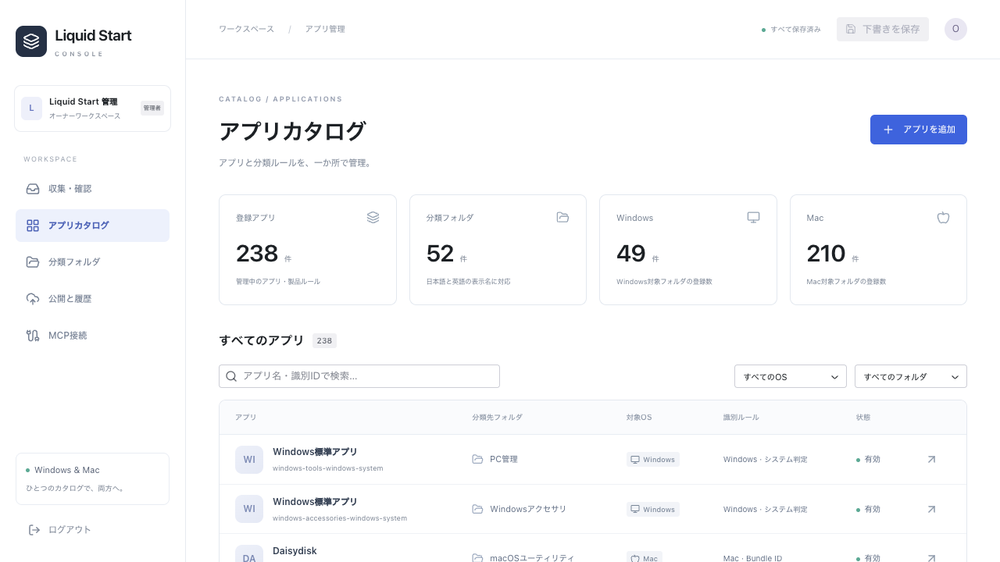
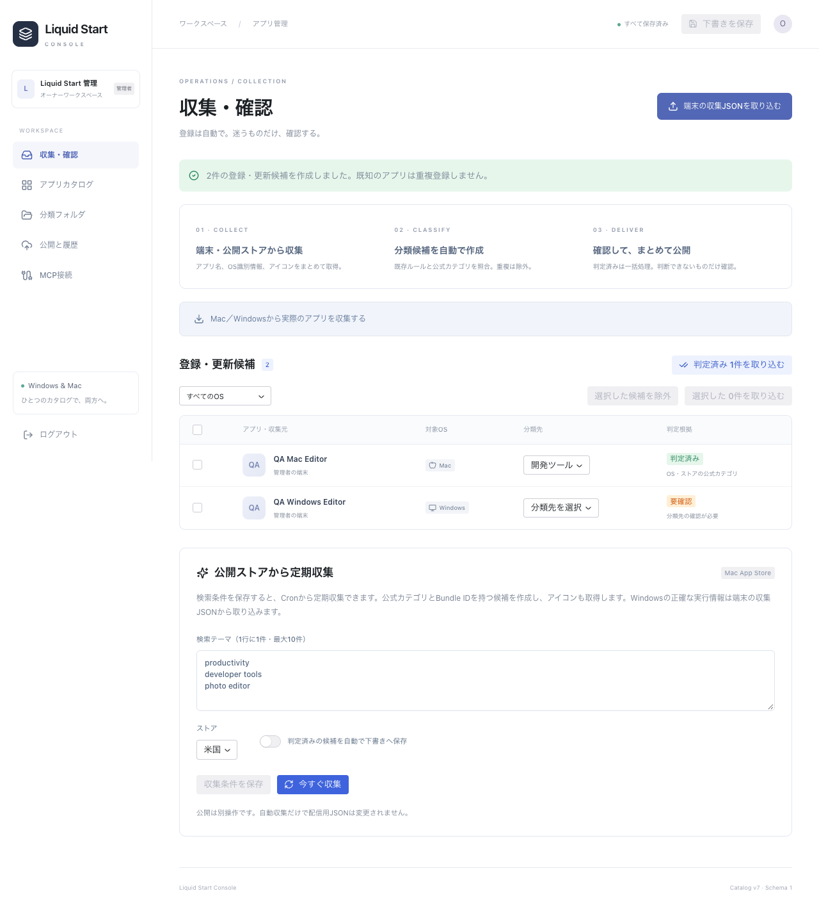
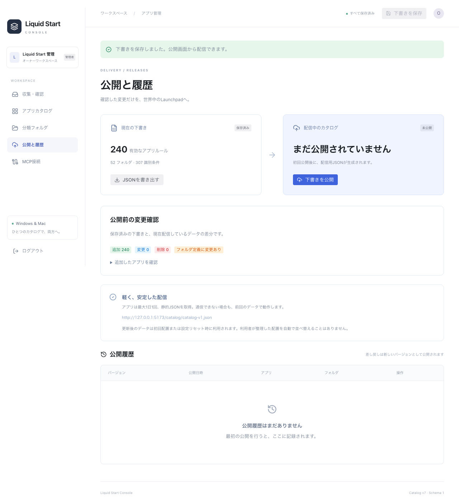
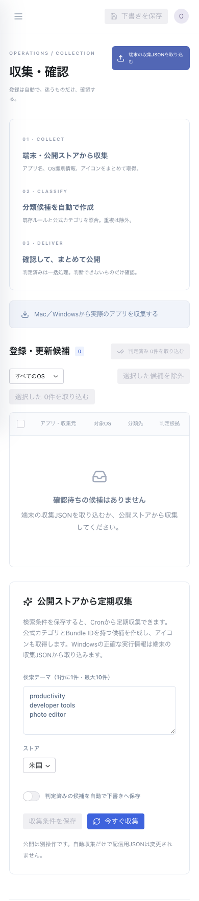

# Liquid Start Console 実装・自己レビュー

## 運用の確認

- 毎回の手入力ではなく「収集→既知判定・カテゴリ提案→一括下書き保存→差分確認→公開」が通常経路。
- WindowsはAUMIDまたは実行ファイル・発行元・製品名、MacはBundle ID、SteamはApp IDを利用。表示名だけの推測は要確認へ。
- 実端末のMacから217件を収集し、217件の識別情報と217件のアイコンを取得。保護対象を除いた211件を一括処理し、238件の同梱データから252件の下書きへ（既存への画像補完も含む）。個別手入力なし。
- PHPで公開した実収集結果をRustの `catalog_validate` で読み込み、v8・252件・52フォルダを確認。
- App Store実APIからPixelmatorの検索結果8件を取得。アイコン取得・公式カテゴリ提案・自動下書き保存まで成功し、公開JSONが未作成のままであることを確認。
- 公開ストアの自動収集はMac App Store対象。Windows/ストア外アプリは端末収集とMCPで補完する。全世界のソフトウェアを自動で完全網羅する機能とはしていない。

## 自己レビューで修正した点

- Reactの下書きは編集開始時のrevisionを保持。再取得で新しいrevisionが届いても、古い編集が他の変更を上書きできない。
- 保存中に追加の編集が発生しても、応答でその編集を消さない。
- 重複する識別ルール、参照先のないフォルダ、Mac/WindowsルールとフォルダのOS不一致をサーバーとRustで拒否。
- Steamのフォルダを管理側で無効にした場合、存在しない固定フォルダIDを返さない。
- 収集を短いバッチに分割し、位置を保存して再開。Cronとブラウザの二重実行は排他。
- 下書き・履歴・設定・セッションを公開ディレクトリから分離。Viteのpublic自動コピーを止め、APIエントリと.htaccessのみ許可してコピー。開発中のpublic/catalogが本番パッケージへ混入しないことをfixtureで検証。設定ファイル・実収集データを除外。
- MCPはBearerハッシュ認証、Origin検証、CSRFと別系統。トークン再発行・失効をブラウザとSDKで確認。
- E2Eは毎回別の一時領域・公開ルート・セッションを作り、開発用データを変更しない。
- PHP 8.2を最低バージョンとしてフォーマッターを設定。PHP 8.5で非推奨になった不要なcurl_closeを除去。

## 検証

- Rust: fmt / Clippy（all-targets・all-features、警告エラー）/ 全ターゲットのテスト / release build。
- 同梱JSONへの移行は既存の初期配置・並び順・保存・undoのテストで検証。
- Rust HTTP試験: 200、ETag、304、不正JSONでも前回キャッシュ維持、版の後退と同番号での書換え拒否。
- TypeScript: strict型チェック、本番ビルド、スキーマ試験。
- PHP: 公開前の下書き分離、競合、差し戻し時の連番、重複収集、一括反映、画像再エンコード、取得先制限、トークンの再発行/失効。
- Chrome E2E: ログイン→Mac/Windows候補取り込み→一括承認→編集→保存→差分確認→公開→静的JSON取得。公式MCP SDKで一覧・取得・保存・競合・失効。未認証/CSRF拒否。390px表示。ページJavaScript例外なし。
- スクリーンショットはWeb管理画面のみ。ネイティブGPU描画は変更していない。既存GPU試験はサンドボックス外で実行。

Windows実端末での新しいexportコマンドの画面/実データ確認と、Xサーバーの本番HTTPS・Cron・PHP CGI配信はこのMac環境では未確認。配布先URLとサーバー設定は運用開始時に設定する。公開はPR内で行わない。

## 画面

